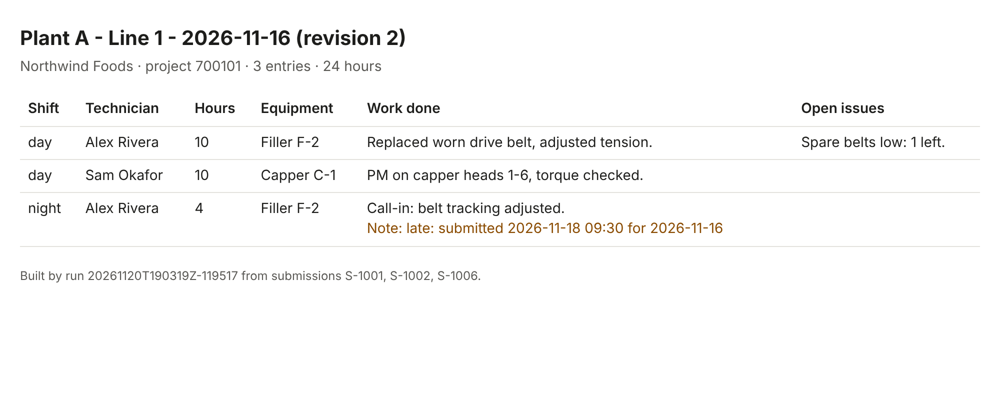
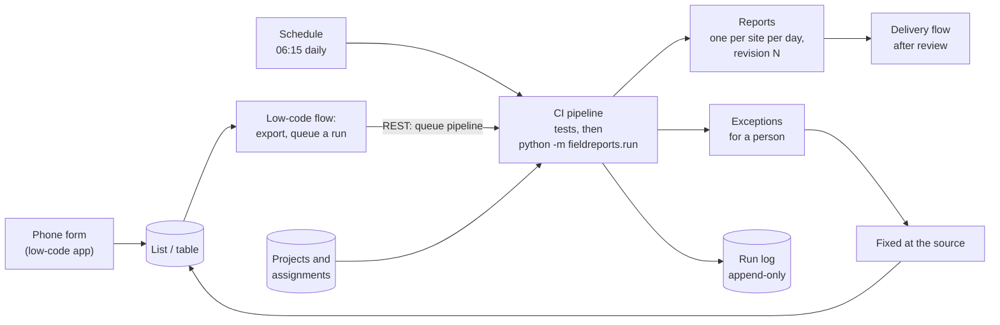

# Field reports pipeline: low-code capture, Python in a pipeline, people own the exceptions

[](https://github.com/devpatram/field-reports-pipeline/actions/workflows/ci.yml)


Technicians at customer sites submit shift entries from their phones. Every morning a pipeline checks them against the
project list and crew assignments, builds one report per site per day, and logs what it did. Anything it cannot
trust goes to a person instead of into a report.

I built and run a production version of this pattern at work on Power Apps, SharePoint, Power Automate and Azure
DevOps. This repo is a from-scratch public version of the pattern with made-up sites, people and data. None of the
work code is here.



## Architecture



The split is deliberate. **Low-code does what it is good at:** the phone form, sign-in, connectors, notifications and
approvals. **Code does the logic:** validation and report building live in a Git repo with tests and run in a
pipeline, because that is where rules can be reviewed, versioned and tested before they touch a customer report.

## What a run does

```
$ python -m fieldreports.run --today 2026-11-18 --out out
Run 20261120T190440Z-b8abf3: 9 received, 6 accepted, 3 report(s) written.
  700101/2026-11-16 rev 1: S-1001, S-1002, S-1006
  700205/2026-11-16 rev 1: S-1003, S-1007
  700311/2026-11-16 rev 1: S-1005
  EXCEPTION S-1004: project 700999 is not in the project list
  EXCEPTION S-1008: missing work_done
  EXCEPTION S-1002: duplicate of an earlier submission S-1002
  warning S-1006: late: submitted 2026-11-18 09:30 for 2026-11-16
  warning S-1007: Chris Wong is not assigned to 700205 on 2026-11-16

$ python -m fieldreports.run --today 2026-11-18 --out out
Run 20261120T190441Z-b404a2: 9 received, 6 accepted, 0 report(s) written.
```

The second run changes nothing because nothing changed. When S-1006 arrives a day late, after the 700101 report was
already built, the next run writes revision 2 of that report only (the picture above; see the tests).

| Design choice | Why |
| --- | --- |
| **Errors stop, warnings travel.** A missing field, unknown project, duplicate or future date stops a submission. A late entry, an unassigned technician or odd hours goes into the report as a visible note. | Nothing is fixed silently, and a report never waits on a judgment call the pipeline cannot make. |
| **Exit code 2 means "finished, with exceptions for a person".** | The pipeline stays green when the data needs a human, and red only when the run itself broke. |
| **Safe to run again.** Each report has a fingerprint of its submissions. Unchanged reports are skipped; a late entry produces revision 2. | Schedules overlap and people press Run twice. Customers get a revision, never a duplicate. |
| **Every report names its sources** (run ID and submission IDs), and every run appends to `runlog.jsonl`. | "Where did this line come from?" has an answer. |
| **Tests run before every run**, in the same pipeline. | A rule change that breaks validation never reaches a customer. |
| **Dry run** parameter: validate and plan, write nothing. | Safe to try a change against real data. |
| **The same CLI runs in Azure DevOps (`azure-pipelines.yml`) and GitHub Actions (`.github/workflows/reports.yml`).** | The pattern does not depend on one vendor's CI. |
| **No secrets in the repo.** In production the flow queues the pipeline through a service connection, and credentials live in the pipeline's secret store. | |

## The same pattern on other platforms

| Piece | Microsoft (what I run at work) | Google Cloud equivalent |
| --- | --- | --- |
| Capture | Power Apps canvas app | AppSheet, or a Forms front end |
| Store | SharePoint list or Dataverse | Sheets, Firestore or Cloud SQL |
| Orchestrate | Power Automate flows | Workflows, Cloud Scheduler, Pub/Sub |
| Run the logic | Azure DevOps pipeline running Python | Cloud Run job running the same container |
| Reports and run log | SharePoint library, list | Cloud Storage, a BigQuery table |
| Secrets | Variable groups, Key Vault | Secret Manager |
| Alerts | Flow notifications on pipeline status | Cloud Monitoring alert on the job's exit code |

## Run it

```bash
pip install -r requirements-dev.txt
pytest -q
python -m fieldreports.run --today 2026-11-18 --out out      # reports in out/, run log in out/runlog.jsonl
python -m fieldreports.run --today 2026-11-18 --dry-run      # plan only
```

The pipeline code uses only the Python standard library.

## Layout

```
fieldreports/
  validate.py   errors and warnings per submission
  report.py     grouping, fingerprints, the HTML report (all text escaped)
  run.py        one run: validate, build what changed, append to the run log; exit codes 0 / 2 / 1
data/           made-up projects, assignments and submissions (one of each problem the checks catch)
tests/          validation, grouping, idempotent re-runs and revisions, dry run, escaping, exit codes
azure-pipelines.yml, .github/workflows/reports.yml   the scheduled run on both CI systems
```

## License

MIT. See [LICENSE](LICENSE).
